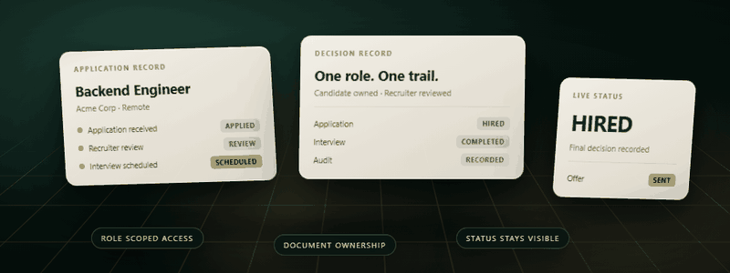
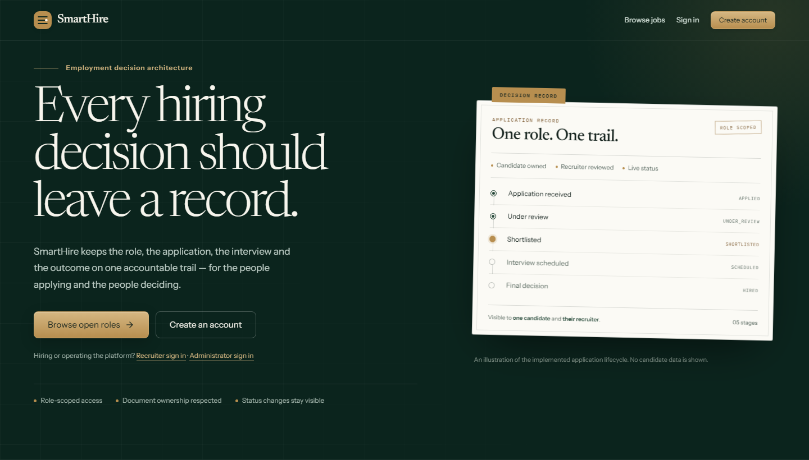
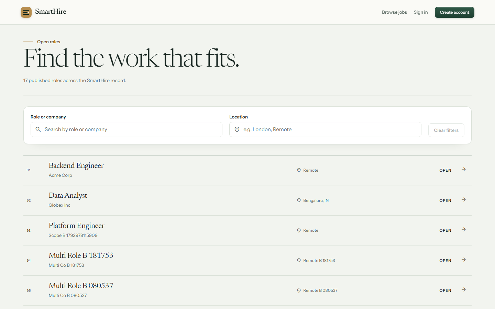
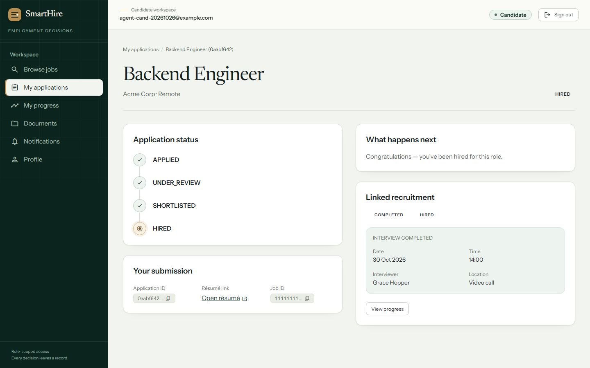
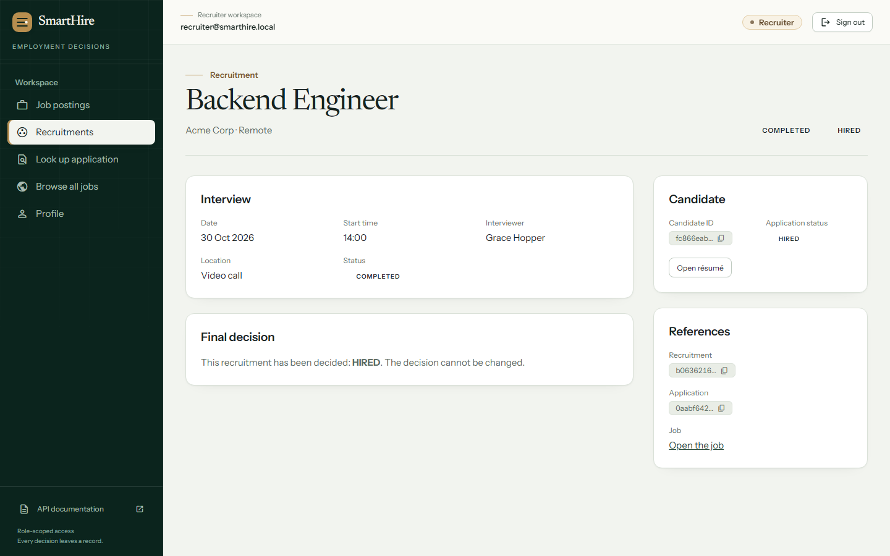
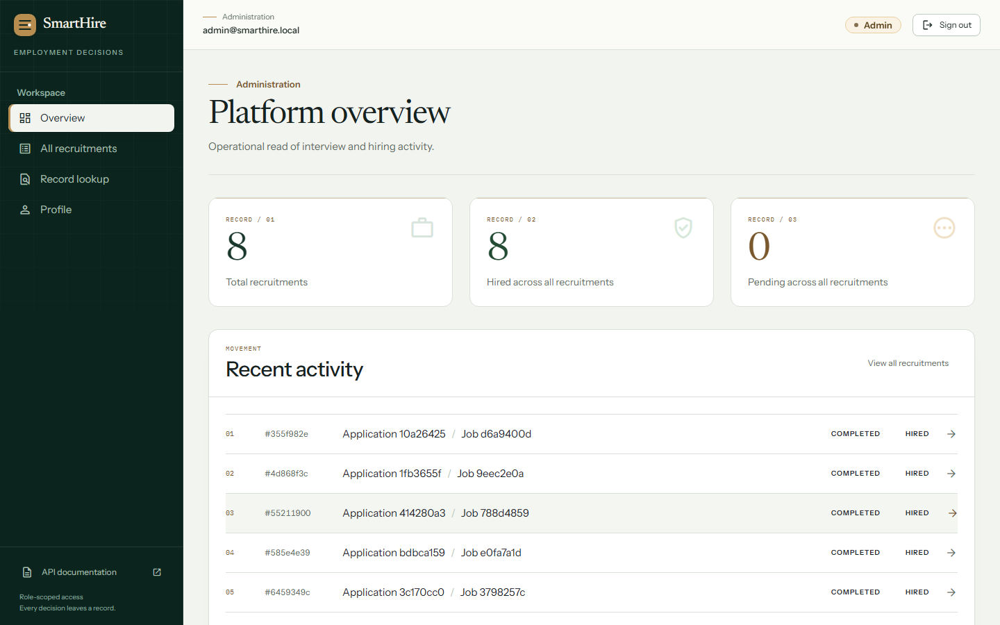
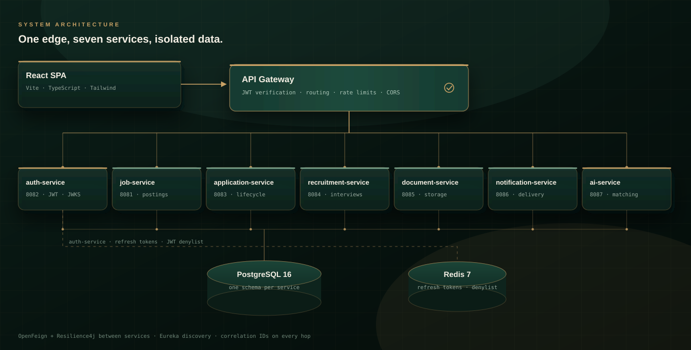
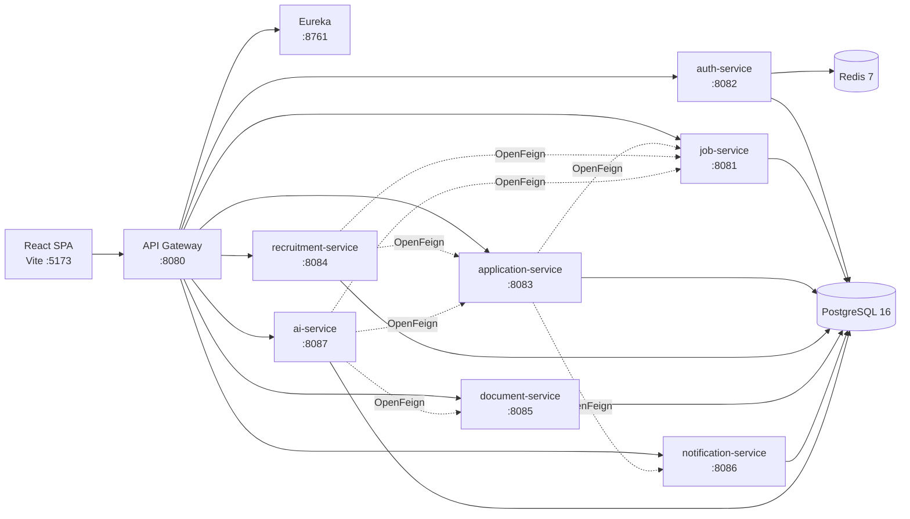

<p align="center">
  
</p>

<h1 align="center">SmartHire</h1>

<p align="center"><strong>Employment decision architecture</strong></p>

<p align="center">
  A full-stack, microservice recruitment platform where every application,<br />
  interview, and hiring decision stays on the record.
</p>

<p align="center">
  <a href="https://github.com/Hareesh-Reddy-9126/PS044-SmartHire/actions/workflows/ci.yml"></a>
  <a href="https://openjdk.org/projects/jdk/21/"></a>
  <a href="https://spring.io/projects/spring-boot"></a>
  <a href="https://react.dev/"></a>
  <a href="https://www.typescriptlang.org/"></a>
  <a href="https://tailwindcss.com/"></a>
  <a href="https://www.postgresql.org/"></a>
  <a href="https://docs.docker.com/compose/"></a>
  <a href="PROJECT_STATUS.md"></a>
</p>

<p align="center"><sub>Verified end to end across candidate, recruiter, administrator, and anonymous journeys.</sub></p>

---

## Contents

- [Overview](#overview)
- [Product tour](#product-tour)
- [What each role can do](#what-each-role-can-do)
- [Architecture](#architecture)
- [Technology stack](#technology-stack)
- [Repository layout](#repository-layout)
- [Quick start](#quick-start)
- [Configuration](#configuration)
- [Roles and routes](#roles-and-routes)
- [API surface](#api-surface)
- [Quality and verification](#quality-and-verification)
- [Security](#security)
- [Known limitations](#known-limitations)
- [Documentation](#documentation)
- [Contributing](#contributing)
- [License](#license)

---

## Overview

SmartHire is built as a set of independently deployable Spring Boot services behind a single Spring Cloud Gateway, with a React single-page application as the client. The backend is the source of truth for authorization; frontend route guards improve navigation but are not a security boundary.

The product is organised around one idea: **a hiring decision should be readable after the fact.** Every application carries its submission, its status trail, the linked recruitment, the interview record, and the final decision — in one place, for the people allowed to see it.

| At a glance | |
|---|---|
| Workspaces | Candidate · Recruiter · Administrator |
| Business services | 7 behind one gateway, plus Eureka discovery |
| Local stack | 11 containers (PostgreSQL, Redis, registry, gateway, 7 services) |
| Frontend | React 18 + TypeScript 5 + Vite, no UI framework |
| Verification | 69 frontend tests · 79/79 live end-to-end checks |

## Product tour



<sub><strong>Public landing page</strong> — role entry points, the hiring lifecycle, and the editorial “decision record” visual language.</sub>

<table>
  <tr>
    <td width="50%">
      
      <br /><sub><strong>Job board</strong> — search, location filter, pagination, and empty states.</sub>
    </td>
    <td width="50%">
      
      <br /><sub><strong>Candidate record</strong> — status trail, submission, and linked recruitment.</sub>
    </td>
  </tr>
  <tr>
    <td width="50%">
      
      <br /><sub><strong>Recruiter workflow</strong> — interview record and the final decision.</sub>
    </td>
    <td width="50%">
      
      <br /><sub><strong>Admin overview</strong> — a read-only operational view of the pipeline.</sub>
    </td>
  </tr>
</table>

## What each role can do

| Workspace | Capabilities |
|---|---|
| **Public** | Paginated job search, location and status filters, job detail pages, apply hand-off, responsive public shell |
| **Candidate** | Applications list and detail, apply and withdraw, progress timeline, document upload/download/delete, notifications, profile |
| **Recruiter** | Job CRUD and lifecycle (draft → open → closed → reopened), job-scoped applicants, application lookup, recruitment creation, interview scheduling and completion, final hire/reject decision |
| **Administrator** | Platform overview, all recruitments, recruitment detail, application lookup, profile — read-only on hiring decisions |

| Platform capability | Implementation |
|---|---|
| Identity | Role-aware self-registration; RS256 access tokens, JWKS verification, Redis-backed refresh sessions and JWT revocation |
| Authorization | Gateway and service-level checks; recruiters are scoped to their own organization, candidates to their own applications |
| Reliability | Eureka discovery, OpenFeign clients, Resilience4j circuit breakers/retries/bulkheads, RFC 9457 error responses, correlation IDs |
| AI service | Deterministic mock provider by default; optional Claude provider with PII redaction, prompt-injection defences, and a kill switch |
| Frontend system | Project-owned accessible primitives, responsive public/auth/workspace shells, reduced-motion support |

## Architecture



- The **API Gateway** is the only public backend entry point. It routes through Eureka and verifies JWTs against the auth-service JWKS.
- Each service owns its **PostgreSQL schema** and Flyway migration history.
- **Redis** holds refresh-token state and the shared JWT `jti` denylist.
- **OpenFeign** calls are protected with Resilience4j fault-tolerance policies.
- **Document storage** is an abstraction with a local volume in the Compose stack; it can be replaced without changing the API.
- **AI** runs as an optional service with a kill switch and a deterministic mock provider for local development.

<details>
<summary><strong>Service dependency graph</strong></summary>



</details>

## Technology stack

| Layer | Technologies |
|---|---|
| Frontend | React 18, TypeScript 5, Vite 5, React Router 6, Tailwind CSS 3, Vitest, Testing Library |
| Backend | Java 21, Spring Boot 3.4.1, Spring Cloud 2024.0.0 (Moorgate), Spring Security 6, Spring Data JPA, Flyway, OpenFeign, Resilience4j |
| Data | PostgreSQL 16 (per-service schemas), Redis 7 |
| API and discovery | REST, RFC 9457 Problem Details, springdoc OpenAPI, Eureka, correlation IDs |
| Delivery | Docker Compose, GitHub Actions, Maven multi-module build, Spotless, SpotBugs, OWASP Dependency-Check |

## Repository layout

```text
.
├── common/                     # Shared correlation-ID filter and problem-details support
├── services/
│   ├── service-registry/       # Eureka discovery server
│   ├── api-gateway/            # Single public entry point, edge security and routing
│   ├── auth-service/           # Accounts, JWT/JWKS, refresh sessions, seeding
│   ├── job-service/            # Job aggregate and lifecycle
│   ├── application-service/    # Applications, status transitions, downstream notifications
│   ├── recruitment-service/    # Recruitment workflow and interviews
│   ├── document-service/       # Document metadata and local storage adapter
│   ├── notification-service/   # Notification records and delivery adapter
│   └── ai-service/             # Matching, parsing, AI provider abstraction, safety controls
├── frontend/                   # React SPA and design system
├── deploy/                     # Docker Compose, environment template, Postman assets
├── docs/                       # Architecture, discovery, governance, roadmap, README assets
├── .github/workflows/          # CI pipeline
└── pom.xml                     # Maven aggregator
```

## Quick start

### Prerequisites

- JDK 21
- Maven 3.9+
- Node.js 18+ and npm 9+
- Docker Desktop with Docker Compose v2

### 1. Clone the repository

```bash
git clone https://github.com/Hareesh-Reddy-9126/PS044-SmartHire.git
cd PS044-SmartHire
```

### 2. Create the local environment file

```bash
cp deploy/.env.example deploy/.env
```

Fill in at least:

- `POSTGRES_USER`
- `POSTGRES_PASSWORD`

To seed demo accounts, also set both values for each account:

- `AUTH_SEED_RECRUITER_EMAIL` and `AUTH_SEED_RECRUITER_PASSWORD`
- `AUTH_SEED_ADMIN_EMAIL` and `AUTH_SEED_ADMIN_PASSWORD`

The seed profile only creates an account when both its email and password are present. `deploy/.env` is git-ignored and must never be committed.

Candidates and recruiters can also create their own accounts from the website. Administrator self-registration is closed by default and opens only when you set a deployment-specific invitation code:

- `AUTH_ADMIN_SIGNUP_CODE` — the code an administrator must present at registration; blank disables administrator signup entirely.

Treat this value as a secret. It is compared in constant time and is never written to logs or returned by the API.

### 3. Start the backend stack

```bash
docker compose -f deploy/docker-compose.yml --env-file deploy/.env up -d --build
```

The first build compiles every Maven module inside Docker and can take several minutes. Useful endpoints:

| Endpoint | URL |
|---|---|
| API Gateway health | <http://localhost:8080/actuator/health> |
| Eureka dashboard | <http://localhost:8761> |
| Public job list | <http://localhost:8080/api/v1/jobs?page=0&size=20> |

The PostgreSQL and Redis ports are intentionally not published to the host by default.

### 4. Start the frontend

```bash
cd frontend
npm ci
npm run dev
```

Open <http://localhost:5173>. Vite proxies `/api`, `/oauth2`, `/actuator`, and `/v3` to the gateway on port `8080`.

For a non-proxied deployment, set `VITE_API_BASE_URL` to the public gateway URL before building.

> Use `http://localhost:5173`, not `http://127.0.0.1:5173`: the default gateway CORS policy allows the `localhost` origin only.

### 5. Stop the stack

```bash
docker compose -f deploy/docker-compose.yml --env-file deploy/.env down
```

Do not add `-v` unless you intend to delete the PostgreSQL and document volumes.

## Configuration

### Backend environment variables

| Variable | Required | Purpose |
|---|---|---|
| `POSTGRES_DB` | No | Database name; Compose defaults to `smarthire` |
| `POSTGRES_USER` | Yes | Shared application database user |
| `POSTGRES_PASSWORD` | Yes | Database password; secret |
| `GATEWAY_CORS_ALLOWED_ORIGINS` | No | Allowed browser origin for the SPA |
| `AUTH_JWT_PRIVATE_KEY` | No | PKCS#8 PEM signing key; an ephemeral development key is generated when blank |
| `AUTH_SEED_RECRUITER_EMAIL` / `AUTH_SEED_RECRUITER_PASSWORD` | No | Development recruiter seed account; both required |
| `AUTH_SEED_ADMIN_EMAIL` / `AUTH_SEED_ADMIN_PASSWORD` | No | Development admin seed account; both required |
| `AUTH_ADMIN_SIGNUP_CODE` | No | Invitation code that enables administrator self-registration; blank disables it; secret |
| `AI_ENABLED` | No | AI kill switch |
| `AI_PROVIDER` | No | `mock` (default) or `claude` |
| `AI_CLAUDE_API_KEY` | No | Required only for the Claude provider; secret |
| `AI_CLAUDE_MODEL` | No | Claude model identifier |

### Frontend environment variables

| Variable | Default | Purpose |
|---|---|---|
| `VITE_API_BASE_URL` | Empty (Vite proxy) | Absolute gateway base URL for non-proxied deployments |
| `VITE_DEBUG` | `false` | Additional client-side logging |

Copy `frontend/.env.example` to `frontend/.env.local` for local overrides. Never commit real credentials or keys.

## Roles and routes

All three roles sign in through the same website. `/login` and `/register` share an accessible role selector, and the role cards on the landing page pre-select the intended role.

- **Candidates** register openly and land in `/candidate/applications`.
- **Recruiters** register openly, must name their organization, and land in `/recruiter/jobs`. Registration creates a dedicated organization so job ownership works immediately, and recruiter job lists are scoped to that organization.
- **Administrators** register only with the deployment's `AUTH_ADMIN_SIGNUP_CODE`, or use a seeded account, and land in `/admin/overview`.

The selected role at sign-in expresses intent only. The role in the JWT and the `/auth/me` response remain authoritative: if the choice does not match the account, SmartHire opens the account's real workspace and shows a dismissible notice instead of ending the session.

| Role | Home | Main routes |
|---|---|---|
| Public | `/jobs` | `/` (landing), `/jobs`, `/jobs/:jobId`, `/login`, `/register` |
| `CANDIDATE` | `/candidate/applications` | Applications, application detail, apply, progress, documents, notifications, profile |
| `RECRUITER` | `/recruiter/jobs` | Jobs, create/edit job, job detail and applicants, recruitments, application lookup, profile |
| `ADMIN` | `/admin/overview` | Overview, recruitments, recruitment detail, application lookup, profile |

- `/` is the public landing page with a workspace entry point for each role and direct access to public job browsing.
- `/workspace` redirects authenticated users to their role home.
- `/403`, `/404`, `/error`, `/offline`, and `/session-expired` are standalone error pages.
- Client-side route guards live in `frontend/src/utils/roles.ts` and `frontend/src/routes/AppRoutes.tsx`.
- Backend authorization is enforced independently by the gateway and each service.

## API surface

All application calls go through the API Gateway at `/api/v1/*`.

| Prefix | Operations |
|---|---|
| `/api/v1/auth/*` | Register (role-aware), login, refresh, logout, current user |
| `/api/v1/jobs/*` | List (`mine=true` limits a recruiter to their organization), get, create, update, open, close, reopen |
| `/api/v1/applications/*` | Candidate list, get, apply, withdraw, recruiter status update, job-scoped list |
| `/api/v1/recruitments/*` | List, get, create, schedule interview, update interview status, final status |
| `/api/v1/documents/*` | List, upload, download, delete |
| `/api/v1/notifications/*` | List and get |
| `/api/v1/ai/*` | Match score, resume parse, candidate summary, job-description assistance |

Errors use RFC 9457 Problem Details. Responses carry a correlation ID so a browser failure can be traced through gateway and service logs.

```bash
curl "http://localhost:8080/api/v1/jobs?page=0&size=20"
```

Interactive API documentation is served at <http://localhost:8080/swagger-ui.html>.

## Quality and verification

### Live end-to-end verification

The complete product was exercised through the real browser UI with six actors — candidate A, candidate B, recruiter A, recruiter B, administrator, and an anonymous visitor — against the running Compose stack.

| Area | Verified behaviour |
|---|---|
| Public | Landing, job search, location filter, pagination, empty state, job detail, apply hand-off, 404, 403, offline, session-expired, error pages |
| Candidate | Register, sign in, apply, withdraw, applications list and detail, documents upload/download/delete, profile, token refresh, notifications |
| Recruiter | Sign in, job list, applicant list, shortlist, schedule interview, complete interview, hire, create job, publish, close, reopen |
| Administrator | Sign in, overview, recruitment list and detail, application lookup, profile, role guard |
| Isolation | Candidate B cannot open candidate A's application; recruiter B cannot see recruiter A's organization; admin is read-only on hiring decisions |
| Persistence | Every transition cross-checked in PostgreSQL: application status, recruitment state, documents, notifications |

**Result: 79 passed · 0 failed · 0 skipped.**

### Frontend

From `frontend/`:

```bash
npm run lint        # ESLint, zero warnings
npm run typecheck   # tsc --noEmit
npm run test:run    # 69 Vitest tests across 11 files
npm run build       # typecheck + production bundle
```

All four gates pass. See [`frontend/README.md`](frontend/README.md) for the full frontend architecture, auth model, route map, and component catalogue.

### Backend

```bash
mvn -B verify
mvn -B spotless:check
mvn -B compile spotbugs:check
mvn -B -Psecurity-scan verify -DskipTests
```

- Unit and integration tests use JUnit 5, AssertJ, MockMvc, and Testcontainers where PostgreSQL is required.
- ArchUnit rules enforce the service architecture.
- Flyway migrations are validated by the application test context.
- Integration tests need Docker. If Docker is unavailable, scope unit tests with `-pl` and `-am`.
- `services/ai-service` unit tests run against in-memory H2; all 52 pass locally (`mvn -pl services/ai-service test`).
- CI runs the full reactor with `mvn -B verify`, so no module is excluded.

### CI

`.github/workflows/ci.yml` runs on `main` and `develop`:

- Maven verify on JDK 21
- Spotless
- SpotBugs
- OWASP Dependency-Check on every push and on pull requests targeting `main`

Test reports and dependency-check reports are uploaded as workflow artifacts.

> The workflow is versioned and ready, but GitHub Actions jobs cannot currently start on this repository because the account's runner allocation is blocked at the account level. The verification evidence in this README comes from local runs against the Compose stack, not from CI.

### Local JDK note

The build targets Java 21. On a newer host JDK, Surefire/Failsafe may require:

```bash
mvn test -Dnet.bytebuddy.experimental=true
```

## Security

- RS256 access tokens are verified with the auth-service JWKS.
- Access tokens stay in memory in the browser; the refresh token is an HttpOnly cookie.
- Refresh-token state and JWT revocation live in Redis.
- Candidate and recruiter self-registration are open; administrator signup requires the deployment's `AUTH_ADMIN_SIGNUP_CODE` and is disabled when the value is blank.
- A recruiter registration creates a dedicated organization, so one recruiter cannot see another organization's draft or closed postings.
- Gateway and service-level authorization enforce ownership and role boundaries.
- No real secrets belong in the repository; use `deploy/.env` or CI secrets.
- `deploy/.env.example` lists keys only and contains no usable credentials.
- AI requests pass through PII redaction and prompt-injection defences; the kill switch can disable the service.
- Errors do not expose stack traces or internal implementation details.

## Known limitations

- Full `mvn verify` and Testcontainers integration tests require Docker; they cannot run in an environment without a Docker daemon.
- External email delivery has not been independently verified. The notification service uses a logging delivery adapter in the current configuration.
- Rapid full-page navigation during silent refresh can replay a just-rotated refresh token; resolving it requires a rotation-grace design decision.
- AI uses the deterministic mock provider by default. The Claude provider requires a key and has not been exercised in CI.
- Password reset and profile-edit backend endpoints are not implemented.
- The admin overview is intentionally limited to verified recruitment data rather than a full analytics suite.
- The deployment target is Docker Compose; Kubernetes, Helm, and Terraform manifests are out of scope.

## Documentation

| Document | Purpose |
|---|---|
| [`PROJECT_CONTEXT.md`](PROJECT_CONTEXT.md) | Durable project context and architecture notes |
| [`PROJECT_STATUS.md`](PROJECT_STATUS.md) | Current verified status, decisions, and limitations |
| [`AGENTS.md`](AGENTS.md) | Agent instructions and verified build/test commands |
| [`frontend/README.md`](frontend/README.md) | Frontend architecture, routes, auth, and design system |
| [`phase2_report.md`](phase2_report.md) | Phase 2 backend integration report |
| [`backend_integration_gaps_summary.md`](backend_integration_gaps_summary.md) | Backend integration gap summary |
| [`docs/architecture/`](docs/architecture/) | Architecture decisions and technical design |
| [`docs/discovery/`](docs/discovery/) | Product model, requirements, and repository assessment |
| [`docs/governance/`](docs/governance/) | Engineering governance and AI development strategy |
| [`docs/roadmap/`](docs/roadmap/) | Implementation roadmap |

## Contributing

1. Create a focused branch from `main`.
2. Keep changes scoped and preserve existing public contracts.
3. Add or update tests for behaviour changes.
4. Run the relevant backend and frontend gates before opening a pull request.
5. Never commit secrets, generated build output, local audit files, or environment files.
6. Use clear commit messages and describe verification evidence in the pull request.

## License

This repository does not currently include a `LICENSE` file. Until one is added, all rights are reserved by the author; contact the maintainer before redistributing or reusing the code.

---

<div align="center">

<sub>Built for <strong>Project 44 — Online Job Recruitment System</strong> · 24SDCS03A/R, SOA Programming and Microservices (AY 2026–27)</sub>

</div>
